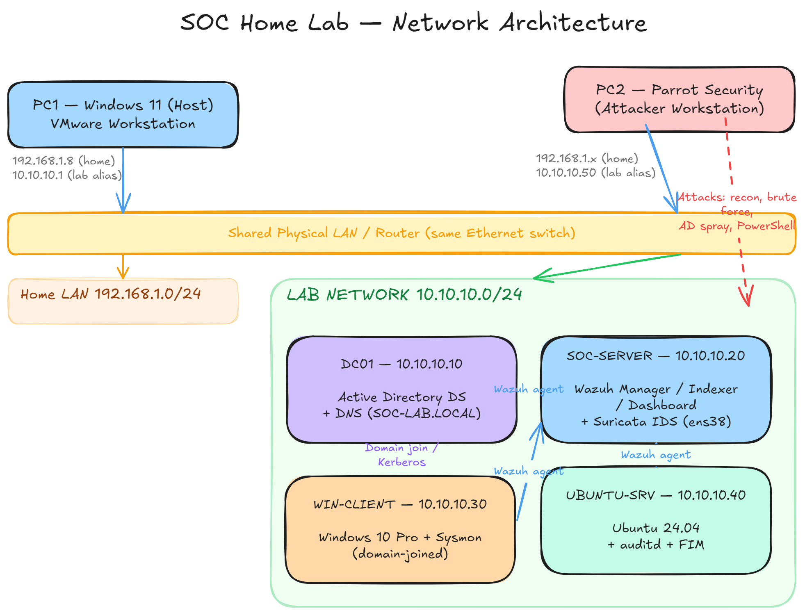

# SOC Home Lab - Cyberattack Detection, Monitoring and Incident Response

A home-built, enterprise-inspired Security Operations Center (SOC) created as a cybersecurity school project. A Wazuh SIEM and a Suricata IDS monitor a small Active Directory environment (a Domain Controller, a Windows workstation and a Linux server) that is attacked in a controlled way from a separate Parrot Security workstation on an isolated lab network. The full cycle is practiced and documented: attack, collect, detect, alert, investigate, contain, remediate, report.

**Status:** Phases 1-9 complete, Phase 10 (final documentation) in progress - see [Project status](#3-project-status).

---

## 1. Objectives

1. Generate controlled cyberattacks against an isolated lab.
2. Collect endpoint and network telemetry centrally.
3. Detect suspicious activity with default and custom rules.
4. Investigate alerts: source, target, user, timeline, impact.
5. Contain and remediate (NIST incident response lifecycle).
6. Document every incident with evidence and a professional report.

## 2. Architecture



*Network architecture: logical isolation on the home LAN via IP aliasing, isolated lab subnet 10.10.10.0/24, and the role of each VM.*

Two physical machines share the home LAN. PC1 (Windows 11, VMware Workstation) hosts the four lab VMs; PC2 (Parrot Security) is the attacker workstation. Neither PC has a second NIC, so the lab subnet 10.10.10.0/24 is created by IP aliasing on the existing interfaces and has no default gateway: the lab is logically, not physically, separated from the home LAN. The VMs attach to it through VMware VMnet0 (bridged), with a temporary NAT adapter (VMnet8) for updates only.

| Component | Role |
|---|---|
| PC1 (Windows 11 + VMware Workstation) | Hosts the 4 VMs |
| PC2 (Parrot Security 7.4) | Attacker workstation (physical machine) |
| SOC-Server | Wazuh manager, indexer and dashboard; Suricata IDS |
| DC01 | Domain Controller (AD DS, DNS) for `SOC-LAB.LOCAL`; Sysmon; Wazuh agent |
| WIN-CLIENT | Domain-joined workstation; Sysmon; PowerShell logging; Wazuh agent |
| UBUNTU-SRV | Linux server; SSH; auditd; FIM; Wazuh agent |

### Network

| Device | Home LAN | Lab IP |
|---|---|---|
| PC1 host | 192.168.1.8 (static) | 10.10.10.1 (alias) |
| PC2 Parrot | 192.168.1.12 (DHCP) | 10.10.10.50 (alias) |
| DC01 | - | 10.10.10.10 |
| SOC-Server | - | 10.10.10.20 |
| WIN-CLIENT | - | 10.10.10.30 |
| UBUNTU-SRV | - | 10.10.10.40 |

Isolation rules:
- Lab IPs have no gateway, so the router never routes 10.10.10.0/24.
- Attack tools are scoped to 10.10.10.0/24 only.
- No home device is placed in 10.10.10.0/24.
- Nothing in the lab is exposed to the internet.

Suricata runs on a dedicated capture vNIC (`ens38`) of SOC-Server (promiscuous mode, no IP) attached to VMnet0, with a BPF filter limited to `net 10.10.10.0/24`. Known limitation: the lab shares the physical wire with home devices; a direct cable or a dedicated switch is a future improvement.

### VM inventory

| VM | OS | vCPU | RAM | Disk | Lab IP |
|---|---|---|---|---|---|
| SOC-Server | Ubuntu Server 24.04.3 LTS | 4 | 8 GB | 80 GB (root LV 78 GB) | 10.10.10.20 |
| DC01 | Windows Server 2019 Standard Evaluation (Desktop Experience) | 2 | 5 GB | 60 GB | 10.10.10.10 |
| WIN-CLIENT | Windows 10 Pro | 2 | 5 GB | 60 GB | 10.10.10.30 |
| UBUNTU-SRV | Ubuntu Server 24.04.3 LTS | 2 | 2 GB | 30 GB (root LV 28 GB) | 10.10.10.40 |

The Domain Controller uses Windows Server 2019 instead of 2022: the 2019 ISO was available, it is lighter, and it is widely used in AD attack and detection labs.

## 3. Project status

| Phase | Description | Status |
|---|---|---|
| 1 | Infrastructure and network preparation | Done |
| 2 | VM deployment | Done |
| 3 | Active Directory | Done |
| 4 | Wazuh SIEM and agents | Done |
| 5 | Endpoint monitoring (Sysmon, auditd, FIM) | Done |
| 6 | Suricata IDS | Done |
| 7 | Attack simulations | Done |
| 8 | Detection engineering | Done |
| 9 | Incident response | Done |
| 10 | Final documentation | In progress |

Day-by-day record: [Documentation/progress-log.md](Documentation/progress-log.md)

## 4. Attack simulations

All attacks stay inside the authorized lab network 10.10.10.0/24. A detection counts as successful only when the event is generated, collected, analyzed and verified.

Attack records:

| ID | Record | Covers |
|---|---|---|
| S1 | [S1_ssh-bruteforce-hydra.md](Attack-Simulations/S1_ssh-bruteforce-hydra.md) | SSH brute force with Hydra from Parrot against UBUNTU-SRV; built-in rules escalated the failures to level 10 brute-force alerts (rules 5712 / 5763). |
| S2 | [S2_network-recon-nmap.md](Attack-Simulations/S2_network-recon-nmap.md) | Nmap SYN, version and OS scan against UBUNTU-SRV; Suricata ET SCAN alerts reached Wazuh, but only at level 3. |
| S3 | [S3_powershell-suspicious-activity.md](Attack-Simulations/S3_powershell-suspicious-activity.md) | Suspicious PowerShell on WIN-CLIENT; built-in Sysmon / PowerShell rules flagged the base64-encoded command at level 12 (rule 92057). |
| S4 | [S4_ad-enumeration-spray.md](Attack-Simulations/S4_ad-enumeration-spray.md) | AD enumeration and NTLM password spray against DC01 with NetExec; 18 x rule 60122 escalated to rule 60204 (level 10), and a Kerberos detection gap was found. |
| S5 | [S5_linux-privesc-persistence.md](Attack-Simulations/S5_linux-privesc-persistence.md) | Local privilege escalation and persistence on UBUNTU-SRV (new sudo user, cron, SUID shell, history clearing); logged only as flat level 3 audit events, which drove Phase 8. |

Incident response reports (NIST SP 800-61 lifecycle; containment, eradication and recovery are documented as recommended procedure, not executed in the lab):

| ID | Report | Covers |
|---|---|---|
| S6 | [S6_incident-response-report.md](Attack-Simulations/S6_incident-response-report.md) | The S4 AD password spray treated as a real incident on DC01. |
| S7 | [S7_linux-privesc-incident-report.md](Attack-Simulations/S7_linux-privesc-incident-report.md) | The S5 Linux attack chain treated as a real incident on UBUNTU-SRV, mapped to the Phase 8 rules. |

## 5. Detection engineering

[Documentation/phase8-detection-engineering.md](Documentation/phase8-detection-engineering.md) documents the custom Wazuh rules 100002-100010 written to close the gaps found in S4 and S5, with the deployed XML, the FIM configuration, validation evidence and known limitations for each:
- **Linux persistence and privilege escalation:** expanded FIM scope and rules for sudoers / cron changes, `/etc/passwd` / `/etc/shadow`, `/tmp` writes, `usermod` / `gpasswd`, SUID bits and `.bash_history` tampering (rules 100002-100004 and 100008-100010).
- **Kerberos spray detection:** rules for event IDs 4771 and 4768 and a frequency rule that escalates a Kerberos password spray to level 12 (rules 100005-100007).

Most rules were validated with a recorded live alert. Rules 100003, 100004 and 100006 are deployed but have no recorded validation alert yet, and several rules have documented limitations (for example, the in-memory `history -c` is still not detected).

Deployed configuration snippets: [Configuration/](Configuration/) (auditd rules, Suricata changes and capture-NIC unit, Wazuh agent localfile snippets).

## 6. Technical report

The full written report covering all phases: [Documentation/technical-report.tex](Documentation/technical-report.tex) (compiled PDF: [Documentation/technical-report.pdf](Documentation/technical-report.pdf)).

## 7. Screenshots

Evidence screenshots are in [Screenshots/](Screenshots/):
- `Screenshots/` (root): infrastructure evidence (`INF-*`).
- [Screenshots/attack-evidence/](Screenshots/attack-evidence/): attack and detection evidence for S1-S6 and Phase 8 (`S*`, `P8-*`).
- [Screenshots/wazuh-dashboard/](Screenshots/wazuh-dashboard/): telemetry evidence (`TEL-*`) and the Phase 8 before-tuning view.

[Screenshots/screenshot-checklist.md](Screenshots/screenshot-checklist.md) tracks which evidence has been captured.

## 8. Open items

Matching the open items in the technical report:
- Tuning of the noisy SURICATA STREAM alerts.
- Scenario 2 fixes: a custom rule raising ET SCAN severity and a correlation rule for repeated scan alerts from one source.
- Validation of rules 100003, 100004 and 100006.
- Detection of in-memory `history -c` / `HISTFILE` tampering (needs shell-session auditing; out of the current scope).
- Phase 10: final documentation.

## 9. Repository structure

```
SOC-Home-Lab/
|-- README.md
|-- Architecture/          soc-architecture.png
|-- Attack-Simulations/    S1-S5 attack records, S6-S7 incident response reports
|-- Configuration/
|   |-- auditd/            soc.rules
|   |-- suricata/          suricata-changes.md, capture-nic.service
|   `-- wazuh/             agent-localfile-snippets.md
|-- Documentation/         technical-report.tex / .pdf, phase8-detection-engineering.md, progress-log.md
`-- Screenshots/           INF-* evidence, attack-evidence/, wazuh-dashboard/, screenshot-checklist.md
```

`Installation/`, `Incident-Reports/`, `Automation/`, `Detection-Rules/`, `Configuration/sysmon/` and `Screenshots/security-alerts/` are empty placeholders. The custom rule XML is currently kept in `phase8-detection-engineering.md`, and the incident reports in `Attack-Simulations/`.

## 10. Conventions

- Screenshot names: `<id>_<description>.png`, for example `S1_ssh-bruteforce-rule5712-nonexistent-user.png` or `P8-01_linux-severity-fix-validated.png`.
- Record real configurations and real results only.
- Never commit passwords, keys, tokens, real logs or personal data. Blur or remove them before uploading.
- Snapshot every VM before major changes.

## 11. Scope and ethics

All attacks target only the authorized lab network 10.10.10.0/24, owned by the author. No lab system is exposed to the internet.

## 12. Tools

Wazuh, Suricata, Sysmon, auditd, Active Directory, VMware Workstation, Parrot Security, Hydra, Nmap, NetExec, kerbrute, PowerShell.
